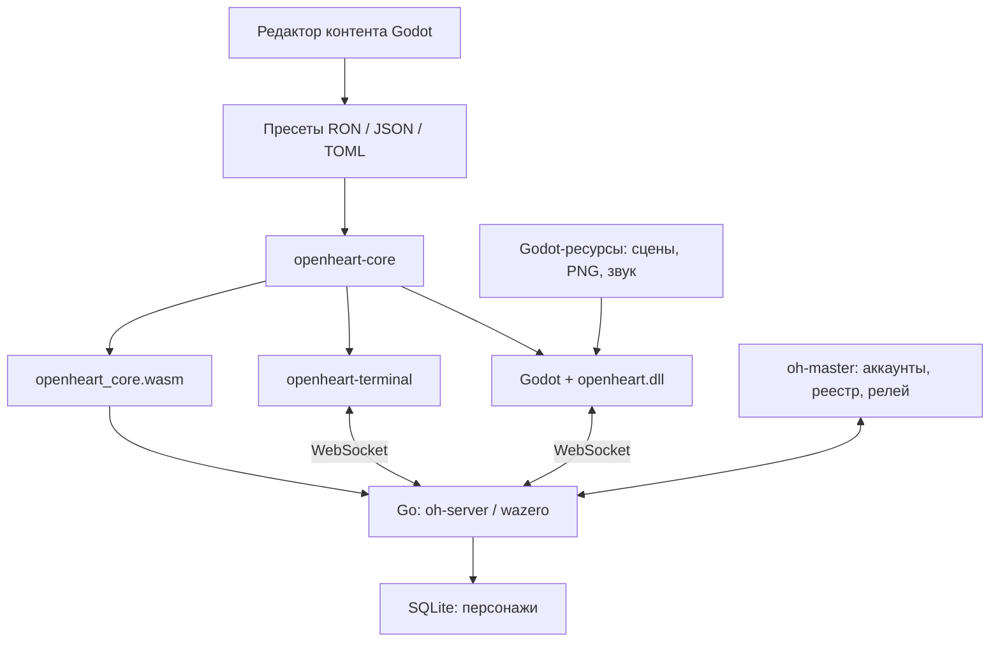
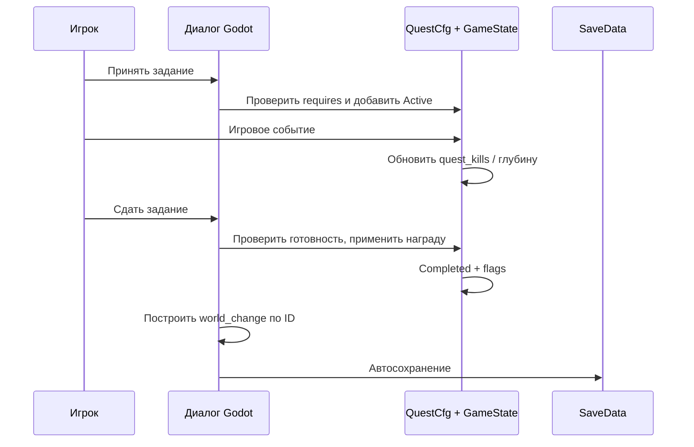

# Архитектура и карта ответственности

Срез: 27.09.2026. [Общее состояние](PROJECT_AUDIT.md) · [исходники по файлам](../INDEX.md) · [сеть](NETWORKING.md).

## Компоненты

В Cargo workspace **три Rust-крейта**: `core`, `client`, `terminal`. Go `server` — отдельный модуль, а не третий Rust-крейт.

| Область | Ответственность | Не следует предполагать |
|---|---|---|
| `core/src/data` | Форматы, классы, предметы, диалоги, конфиг, hash | Что все поля реализованы во всех клиентах |
| `core/src/combat` | Общие определения оружия, перков, статусов, умений | Что каждый Godot-эффект перенесён в сетевую симуляцию |
| `core/src/state` | `GameState`, эффекты и `SaveData` | Что прогресс автоматически серверно-авторитетен |
| `core/src/worldgen` | План данжа, навигация, схемы карты | Что здесь создаются Godot-меши |
| `core/src/sim` | Серверная/терминальная симуляция, бой, loot, party, rescue | Полный паритет с `client/.../combat.rs` |
| `core/src/ai` | Небольшая сеть выбора намерений и fallback | Наличие обученных весов в поставляемом пресете |
| `client/src/nodes` | Godot-узлы, местная боёвка, панели, ввод и представление | Только «тонкий рендер» над core: логики здесь пока много |
| `client/src/worldgen` | Геометрия и визуальное воплощение плана | Полностью динамический стриминг мира |
| `terminal/src` | TUI, сетевой/локальный запуск, команды, представление | Графические и физические возможности Godot |
| `server/internal` | Комнаты, хранение, auth, реестр, relay, wasm-host | Вторую полную реализацию боевой системы на Go |
| `game` | Проект Godot, сцены, ресурсы, данные, редактор и QA-скрипты | Только ассеты: здесь также есть исполняемый GDScript |

## Game3D и жизненный цикл

`client/src/nodes/game/mod.rs` хранит поля и режимы Game3D. Реализация разделена на `lifecycle`, `gameplay`, `combat`, `abilities`, `delve`, `environment`, `conversation`, `items`, `shop`, `crafting`, `interface`, `presentation`, `campaign`, `creative`, `net` и проверки. Это не один `game.rs` на несколько тысяч строк, но связанность через большое общее состояние сохраняется.

Порядок загрузки в `lifecycle.rs`:

1. Настройки и запрос креатива. Креатив не читает сейв кампании и отключает её автосохранение.
2. Загрузка персонажа; пресет сохранения приоритетнее выбранного в меню.
3. `content::load_preset` и `GameConfig::load_from`.
4. `map::load_map(..., "hub")`; при успехе геометрия, окружение и спавны карты, иначе legacy-мир.
5. Последствия боссов и завершённых заданий, NPC, HUD, экран класса и панели.
6. Применение loadout, сетевые/локальные режимы и игровой цикл.

`Mode` управляет исследованием, диалогом, инвентарём, перками, магазином, крафтом, смертью, креативом и эпилогом. Смена UI-режима и заморозка игрока — не универсальная остановка серверного времени.

## Данные и совместимость

`format::find` ищет один stem в порядке **`.ron`, `.json`, `.toml`**. Некоторые загрузчики нормализуют его в JSON перед разбором. Манифест и контент используют свои структуры и дефолты; не следует выводить поддержку наследования только из наличия поля `base`.

В Godot `preset_base` сначала проверяет `res://presets/<id>`, затем `user://presets/<id>`. Пользовательская папка не является автоматическим переопределением встроенного пресета с тем же ID. Для мода нужен ясный отдельный идентификатор и проверка загрузки.

Fallback на встроенный `core` помогает запуску при ошибке данных, но может скрывать проблему авторского пресета. Всегда читать предупреждения и проверять именно активный набор. Некоторые общие загрузчики используют глобальное хранилище и `Box::leak`; многократная смена больших пресетов требует отдельного профилирования памяти.

Content hash: сортированные относительные пути и содержимое `.json/.ron/.toml`, SHA-256, удаление `\r`. Пробелы и табы **не нормализуются**, PNG в хеш не входят. Косметическое переформатирование может изменить сетевой отпечаток. Реализации: [Rust](../../core/src/data/hash.rs), [Go](../../server/internal/content/content.go).

## Поток задания

События квестов и выбор сцены пока находятся в Godot-слое, а не полностью в универсальном квестовом движке core. Терминал имеет свой адаптер. `GameState::apply` защищает от повторного пакета завершения, но не знает сам по себе всех условий `QuestCfg`; проверки цели и зависимостей делает вызывающий слой.

## Изображения диалогов

`Line.portrait` — старый ключ NPC либо явный ресурс `res://assets/...png/.tres`. `dialogue::artwork_path` сохраняет совместимость с `_city` и запрещает неподходящие пути. UI перед загрузкой очищает предыдущую текстуру; текст прокручивается отдельно. Изображение не меняет ID говорящего, события квеста и правила награды.

## Сохранения

Формат **SaveData v4**, реализация [core/src/state/save.rs](../../core/src/state/save.rs). Хранит персонажа, прогресс, инвентарь, класс/спек, перки, арсенал, квесты, счётчики, флаги и состояние умений. Новые совместимые поля получают `serde(default)`.

Godot сохраняет в `user://save.json`, настройки — отдельно; терминал и сервер используют свои места хранения, описанные в [NETWORKING.md](NETWORKING.md). Нельзя обещать восстановление точной расстановки врагов незавершённого похода только потому, что восстановился персонаж.

## Границы, важные для изменений

- Изменение `.rs` требует новой DLL и перезапуска сцены/процесса; старая DLL может успешно запускаться со старым поведением.
- Изменение данных требует синхронизации JSON/RON и хеша; новая картинка — импорта Godot и проверки экспорта.
- Новые базовые механики, типы урона, слоты оружия и команды протокола требуют кода. Не всё расширяется записью в JSON.
- Серверный тик и локальная физика — разные исполнения. Тест чистого ядра не проверяет Godot-коллизии, UI и импорт ресурсов.
