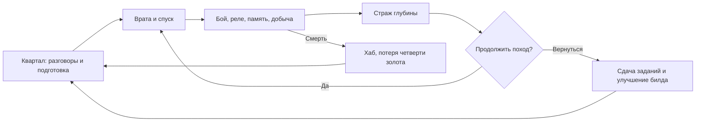

# Геймплей OpenHeart

Область: основная кампания Godot-клиента, пресет `core`, срез 27.09.2026. Отличия других клиентов — в [NETWORKING.md](NETWORKING.md). Оценка качества и приоритеты — в [PROJECT_AUDIT.md](PROJECT_AUDIT.md).

## Концепция и игровой цикл

OpenHeart — действие от первого лица в 3D-мире с двумерными персонажами и оружием, RPG-прогрессией и сюжетным кварталом. Главные герои — взрослые мужчины-фембои; неоновая готика соединяется с современной техникой и повседневной жизнью жителей. NPC имеют разные идентичности; канон героев не означает одинаковый пол всех жителей.

Риск похода — здоровье, боезапас и часть золота. Возвращение позволяет сдать задания, потратить ресурсы и увидеть последствия для квартала. Персонаж и его прогресс переживают смерть; это не удаление сейва.

## Режимы

| Режим | Для чего | Ограничения |
|---|---|---|
| Кампания `core` | Квартал, цепочки заданий, четыре основных стража и финал | Полный ручной релизный проход ещё не подтверждён этим аудитом |
| Креатив | Проверка оружия, классов, глубин 1–8, перков и внешности | Отдельная сессия без записи кампании; не редактор строительства |
| Кнопка боевой арены | Тестовые волны лёгких, смешанных и тяжёлых врагов в креативе | Нельзя приравнивать к самостоятельной сбалансированной кампании |
| Пресет `arena` | Отдельные тестовые данные | В `preset.toml` отключён (`enabled=false`); это не та же сущность, что кнопка арены |
| Сетевой / терминальный | Общий мир и бой на `core::sim` | Неполный паритет с локальной Godot-боёвкой |

Источники: [creative.rs](../../client/src/nodes/game/creative.rs), [main_menu.rs](../../client/src/nodes/main_menu.rs), [arena/preset.toml](../../game/presets/arena/preset.toml).

## Управление Godot-клиента

| Клавиша | Действие |
|---|---|
| WASD, мышь | Движение и обзор |
| Shift / Space | Спринт / прыжок |
| ЛКМ / ПКМ | Основной / альтернативный огонь |
| 1–8 / колесо | Выбор оружия |
| R | Перезарядка |
| F / G | Два классовых умения |
| E | Взаимодействие, следующая реплика, возрождение на экране смерти |
| Q | Быстрое лечение расходником |
| I / P / C | Инвентарь / перки / крафт |
| J / T | Журнал / смена отслеживаемой цели |
| Esc | Закрытие панели или пауза по текущему режиму |
| F2 | Панель креатива в креативной сессии |

Диалоговые ответы доступны кнопками; числовые клавиши зависят от экрана. В терминале другая раскладка: Q/F для умений, Space для атаки — см. [его руководство](../../terminal/README.md).

## Классы и специализации

| Класс | Начальный стиль | Специализации | Умения |
|---|---|---|---|
| Берсерк (`berserk`) | Клинок и пила, ближний бой | Кровожнец, Таран, Вихрь | Кровавый порыв, Жатва |
| Штурмовик (`vanguard`) | Пистолет и дробовик, близкая дистанция | Экзекутор, Бастион, Дуэлянт | Импульс, Бастион |
| Оператор (`operator`) | Дистанционный технологический бой | Снайпер, Подрывник, Техник | Дуга, Разлом |

Специализация меняет параметры, а не добавляет новый независимый класс. Последние изменения включают множитель восстановления и дополнительный заряд выбранного умения у отдельных специализаций. Точные значения: [classes.json](../../game/presets/core/classes.json), [player_abilities.json](../../game/presets/core/player_abilities.json); исполняется предпочитаемая RON-копия. `abilities.json` — другой набор, способности врагов; его нельзя смешивать с шестью умениями игрока.

## Бой

- Восемь видов оружия: клинок, пила, пистолет, дробовик, автомат, гвоздемёт, плазма, ракетница. Каталог `WeaponId` фиксирован кодом: полностью новый девятый слот потребует изменения движка.
- Локальная Godot-боёвка использует hitscan, melee и снаряды со сплэшем; есть перезарядка, альтернативный огонь, боевые эффекты и обратная связь HUD.
- Типы урона: физический, огонь, энергия, пустота. Уязвимости и сопротивления задаются у врагов.
- 21 определение врага не означает 21 уникальный рисунок. Роли и параметры различаются; часть использует общий визуальный ресурс.
- Перки и модификации меняют билд. Сейчас в данных 21 перк, 11 синергий и 16 модификаций оружия; статические иконки не являются описанием всей механики.

Источники: [combat.rs](../../client/src/nodes/game/combat.rs), [weapon.rs](../../core/src/combat/weapon.rs), [WEAPON_BALANCE.md](../WEAPON_BALANCE.md).

## Мир и подземелья

Хаб строится из `maps/hub.*`, NPC — из `npcs.*`. При отсутствии карты существует legacy-генерация. В рабочей карте есть районы, вертикальные маршруты и станции; это одна составная карта, а не автоматически шесть загружаемых уровней.

В данных подземелий: пять тем и 16 архетипов комнат. Генератор распределяет боевые, безопасные, ритуальные, сокровищные, вертикальные, сюжетные комнаты и головоломки. Реле появляются с глубины 2, эхо памяти — с глубины 3. Точный план зависит от seed.

| С глубины | Страж |
|---:|---|
| 1 | `crypt_warden` |
| 2 | `blood_oracle` |
| 3 | `archive_sentinel` |
| 4 | `heart_tyrant` |

После поражения Тирана и возвращения домой одиночная кампания показывает эпилог. Можно продолжать незавершённые задания и экспедиции. Наличие пятой темы и доступ к глубинам выше четырёх не означают дополнительные авторские главы. См. [dungeon.json](../../game/presets/core/dungeon.json) и [campaign.rs](../../client/src/nodes/game/campaign.rs).

## Прогрессия и экономика

XP даёт уровни и очки перков; предметы и оружие расширяют набор решений. Торговец продаёт расходники, боезапас и ядра модификации; часть предметов можно продавать. Текущие константы: набор патронов 20 золота, ядро 120; первый сброс перков бесплатный, последующие — 100. Значения — срез, не утверждённый финальный баланс.

Восемь рецептов крафта проверяют материалы, станцию и флаг открытия. В Godot вызов выполняет преобразование инвентаря локально. Наличие поля `time` в рецепте не доказывает реализованный серверный таймер изготовления.

При смерти в одиночной игре теряется `gold / 4` с целочисленным округлением вниз; игрок возвращается в хаб, статусы снимаются, текущий данж очищается. Кампания не стирается. Источники: [gameplay.rs](../../client/src/nodes/game/gameplay.rs), [shop.rs](../../client/src/nodes/game/shop.rs), [crafting.rs](../../client/src/nodes/game/crafting.rs), [game_state.rs](../../core/src/state/game_state.rs).

## Задания и жизнь квартала

41 задание организовано в 15 именованных цепочек; список и размеры — в [инвентаризации](../_generated/INVENTORY.md). Важные типы: убийство, сбор, разговор, прохождение глубины, босс, открытие оружия, решение реле и чтение памяти.

У событийных задач прогресс обычно начинается после принятия. `clear_dungeon` использует уже достигнутую глубину. Сбор в существующих заданиях часто означает фиксацию находок, а не изъятие вещей; всегда читать описание. Условия сдачи и однократность награды проверяются кодом.

Эпизод [«Свет для общего стола»](../CONTENT_UPDATE_SHARED_TABLE.md) продолжает истории Эш, Ноэля, Люсьена и Эмиля. Его финал даёт общий стол и новые разговоры, а не новую систему сидения или полноценную постановку NPC в 3D.

## Внешность

Гардероб использует готовые аксессуары и сохраняемый выбор. Сейчас он показывает иллюстрации и эмблему выбранного аксессуара; свободная смена всех частей тела, рук и боевых спрайтов не реализована. Образ в портрете и мировой спрайт могут расходиться — это задача художественной доработки.
